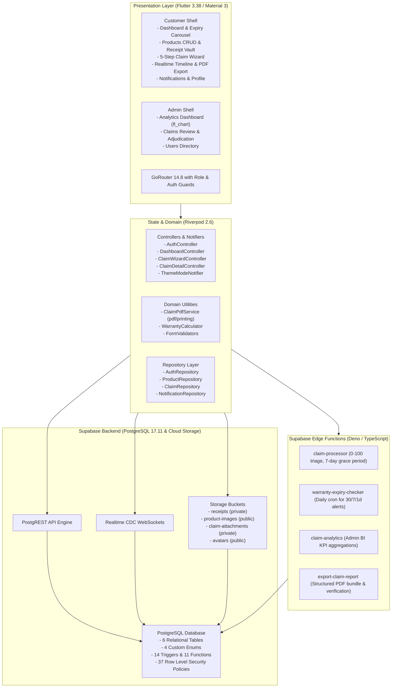

# Claimly — Automated Warranty & Refund Claim Assistant

[](https://flutter.dev)
[](https://dart.dev)
[](https://supabase.com)
[](test/)
[](analysis_options.yaml)
[](LICENSE)

**Claimly** is an automated warranty and refund claim assistant mobile and desktop application. Engineered with **Flutter 3.x** and **Supabase**, Claimly centralizes product purchases, monitors warranty expiration deadlines, automates priority triage scoring, enables client-side PDF claim dossier export, and synchronizes real-time status updates between consumers and retail store administrators.

---

## Key Features

### Customer Experience
- **Digital Warranty Vault**: Register products with model and serial numbers, category tags, and encrypted receipt uploads to private storage buckets.
- **Proactive Expiry Alerts**: Automated countdown tracker with alerts at 30 days, 7 days, and 1 day prior to warranty expiration.
- **5-Step Claim Filing Wizard**: Streamlined stepper flow guiding users through product selection, resolution type (`warranty`, `refund`, `replacement`), failure symptoms, evidence attachments, and pre-submission triage review.
- **Automated Triage & Priority Scoring**: Serverless edge engine calculating transparent priority scores (0–100) based on urgency, type, safety NLP keywords, and proof completeness.
- **7-Day Warranty Grace Period**: Automated boundary evaluation accepting failure incidents occurring within 7 calendar days post-expiration.
- **Realtime Status Timeline**: Live vertical audit trail updating instantaneously via Supabase Realtime WebSockets when administrators review or adjudicate claims.
- **Client-Side PDF Claim Export**: Instant on-device ISO A4 document compilation with metadata, audit logs, and anti-fraud 2D QR verification codes.
- **Light & Dark Theming**: Material 3 theming with local persistence via `SharedPreferences`.

### Administrator Experience
- **Role-Guarded Admin Console**: Protected by GoRouter redirect guards and PostgreSQL Row Level Security (RLS).
- **Business Intelligence Analytics**: Interactive `fl_chart` charts rendering claim status distributions, type breakdowns, 30-day submission timelines, and top failure categories.
- **Claims Adjudication Queue**: Filterable and searchable review list with status updates (`under_review`, `approved`, `rejected`, `completed`), priority slider overrides, internal staff notes, and customer resolution summaries.
- **User Directory**: Searchable customer directory with role badges and account metrics.

---

## System Architecture



---

## Technology Stack

| Component | Technology | Version | Purpose |
|---|---|---|---|
| **Frontend Framework** | Flutter | `3.38.9` | Cross-platform UI (Android, iOS, Web, Linux Desktop) |
| **Language** | Dart | `3.10.0+` | Core application logic |
| **State Management** | Riverpod | `2.6.1` | Reactive dependency injection and unidirectional state flow |
| **Navigation** | GoRouter | `14.8.0` | Declarative routing with reactive auth & admin guards |
| **Backend & Database** | Supabase / PostgreSQL | `17.11` | Relational database, PostgREST API, GoTrue Auth, Realtime |
| **Serverless Functions**| Deno / TypeScript | `1.37.0+` | Edge computing for triage scoring and cron daemons |
| **Data Visualizations** | `fl_chart` | `0.68.0` | Interactive admin KPI analytics charts |
| **Document Compiler** | `pdf` & `printing` | `3.10.8` / `5.12.0` | Client-side ISO A4 PDF generation with QR codes |
| **Testing Harness** | `mocktail` & `integration_test` | `1.0.4` | Mocking, widget testing, and end-to-end integration flows |

---

## Project Structure

```
Claimly/
├── .env.example                                # Environment configuration template
├── pubspec.yaml                                # Dependencies and asset mappings
├── analysis_options.yaml                       # Strict linter rules (zero errors/warnings)
├── README.md                                   # Project overview and quick start
├── docs/
│   ├── PROJECT_REPORT.md                       # Comprehensive 8-chapter engineering report
│   ├── API_DOCUMENTATION.md                    # Database schema, RLS, buckets & Edge functions
│   ├── SETUP_GUIDE.md                          # Step-by-step setup and build instructions
│   └── USER_MANUAL.md                          # Customer and admin walkthroughs with 10 FAQs
├── supabase/
│   ├── config.toml                             # Local Supabase CLI configuration
│   ├── schema.sql                              # Standalone PostgreSQL DDL
│   ├── migrations/                             # Timestamped migration scripts
│   └── functions/                              # 4 Deno/TypeScript Edge Functions
├── lib/
│   ├── main.dart                               # Application bootstrap & provider setup
│   ├── app.dart                                # MaterialApp.router & theme binding
│   ├── core/                                   # Constants, errors, router, theme, widgets, validators
│   └── features/
│       ├── auth/                               # Login, register, forgot password, auth controller
│       ├── customer/                           # Dashboard, products, 5-step claim wizard, notifications, profile
│       └── admin/                              # BI dashboard, claims review adjudication, user directory
├── test/
│   ├── core/                                   # Theme, validators, formatters, and core widget tests
│   ├── unit/                                   # Domain model, repository, and controller tests
│   ├── widget/                                 # Isolated UI and screen tests
│   └── e2e/                                    # 30 master opaque-box E2E suites (110 test cases)
├── integration_test/                           # Headless Flutter integration test suites
└── tool/
    ├── run_e2e_tests.sh                        # Master automated test runner CLI
    ├── seed_test_db.sh                         # Database seeding and fixture management utility
    └── seed_demo_data.sh                       # Presentation & demo multi-persona data seeder
```

---

## Quick Start Guide

### 1. Prerequisites
- Flutter SDK `>=3.19.0` (Dart `>=3.3.0`)
- Supabase CLI `>=1.140.0`
- Docker Engine `>=24.0.0` (for local Supabase container stack)

### 2. Setup Environment
```bash
# Clone the repository
git clone https://github.com/swayam-shah/Claimly.git
cd Claimly

# Copy and configure environment variables
cp .env.example .env
# Edit .env with your Supabase credentials
```

### 3. Install Dependencies & Build
```bash
flutter pub get
dart run build_runner build --delete-conflicting-outputs
```

### 4. Run Application
```bash
# Web (Google Chrome)
flutter run -d chrome

# Linux Desktop
flutter run -d linux

# Android Device / Emulator
flutter run -d <device-id>
```

---

## Testing & Quality Assurance

Claimly maintains strict code quality and verification standards:

```bash
# 1. Verify static code analysis (0 errors, 0 warnings)
flutter analyze

# 2. Run unit, widget, and core tests (123 tests passing)
flutter test test/core/ test/unit/ test/widget/ test/widget_test.dart

# 3. Run headless integration tests (3 suites)
./tool/run_e2e_tests.sh -i

# 4. Run master opaque-box E2E suite (30 suites, 110 test cases)
./tool/run_e2e_tests.sh --all

# 5. Run specific test tier
./tool/run_e2e_tests.sh --tier 1   # Feature Coverage (35 cases)
./tool/run_e2e_tests.sh --tier 2   # Boundary & Corner Cases (35 cases)
./tool/run_e2e_tests.sh --tier 3   # Cross-Feature State Synchronization (15 cases)
./tool/run_e2e_tests.sh --tier 4   # Real-World User Journeys (5 cases)
./tool/run_e2e_tests.sh --backend  # Backend Contracts (20 cases)
```

---

## Documentation Index

Explore the comprehensive project documentation in the `docs/` folder:
- **[Project Engineering Report](docs/PROJECT_REPORT.md)**: 8-Chapter comprehensive academic/engineering report including literature survey, requirements analysis, 6 Mermaid design diagrams, implementation specifications, verified test case matrix, and security audit.
- **[API & Database Documentation](docs/API_DOCUMENTATION.md)**: Complete database schema reference, custom enums, SQL functions, triggers, 37 Row Level Security (RLS) policies, storage buckets, and Edge Function JSON contracts.
- **[Setup & Deployment Guide](docs/SETUP_GUIDE.md)**: Step-by-step developer setup, database migration, Edge Function deployment, and test execution instructions.
- **[Live Presentation & Demo Walkthrough](docs/DEMO_WALKTHROUGH.md)**: Stage-ready 4-act live presentation script with realistic test personas, real-time WebSocket sync demo, and PDF export guide.
- **[User & Administrator Manual](docs/USER_MANUAL.md)**: Screen-by-screen walkthrough for customers and administrators, 5-step wizard guide, and 10 troubleshooting FAQs.

---

## License

This project is licensed under the MIT License — see the [LICENSE](LICENSE) file for details.
