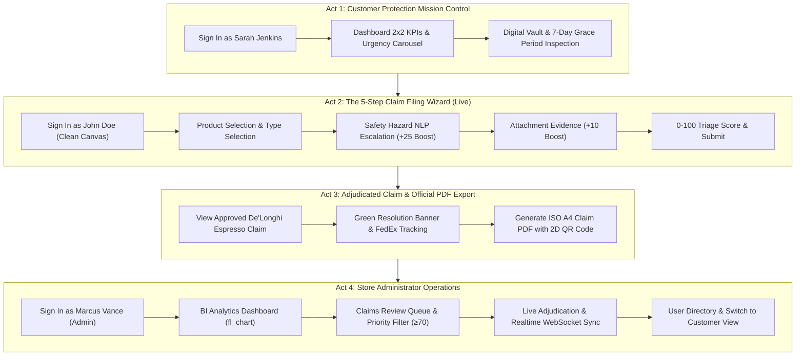

# Claimly — Live Presentation & Demo Walkthrough Script

This document provides a turnkey, stage-ready presentation guide for showcasing all features, workflows, and real-time capabilities of **Claimly** to an audience, panel, or stakeholder review.

---

## 1. Quick Presentation Setup (1-Minute Preparation)

### Step 1: Seed the Databasesl
Run the presentation seeder to populate realistic multi-persona data, 30-day historical analytics, active claims, urgency alerts, and storage fixtures:
```bash
./tool/seed_demo_data.sh --seed
```
*(Or `./tool/seed_test_db.sh --demo`)*

### Step 2: Launch the App
Launch Claimly in Google Chrome (recommended for opening side-by-side tabs):
```bash
flutter run -d chrome
```

---

## 2. Presentation Personas Matrix

| Persona | Email | Password | Role | Presentation Stage |
|---|---|---|---|---|
| **Sarah Jenkins** | `sarah.jenkins@claimly.com` | `SecureP@ss2026!` | **Customer** | **Act 1 & Act 3**: Digital Vault, Expiry Carousel, Approved Claim, and Client-Side PDF Export. |
| **John Doe** | `john.customer@claimly.com` | `CustomerPass123!` | **Customer** | **Act 2**: Clean canvas for live-filing a brand new claim through the 5-Step Stepper Wizard. |
| **Marcus Vance** | `marcus.admin@claimly.com` | `AdminSecret2026!` | **Admin** | **Act 4**: Role Guards, BI Analytics Dashboard, Adjudication Queue, Realtime WebSocket sync, and Users Directory. |
| **David Chen** | `david.chen@claimly.com` | `CustomerPass123!` | **Customer** | Multi-tenant tenant isolation (RLS), Rejected physical damage claims, and Completed repair workflows. |

---

## 3. The 4-Act Live Presentation Script



---

### Act 1: Customer Protection Mission Control (Sarah Jenkins)
> **Goal**: Show proactive warranty management, dynamic expiry urgency tiers, and the product vault.

1. **Sign In**:
   - Navigate to `/login`.
   - Enter `sarah.jenkins@claimly.com` / `SecureP@ss2026!`.
   - *Key Talking Point*: Explain session persistence and Supabase GoTrue authentication.
2. **Dashboard Overview (`/customer/home`)**:
   - Highlight the **2x2 KPI Metric Cards**:
     - *Active Warranties (2)*: MacBook Pro & Espresso Machine.
     - *Expiring Soon (2)*: Dell Monitor & Sony Headphones.
     - *Pending Claims (1)*: MacBook Pro screen line defect under review.
     - *Resolved Claims (1)*: Espresso Machine approved replacement.
   - Point out the **Expiry Alert Carousel**:
     - **Red Critical Alert**: *Sony WH-1000XM5 Wireless Headphones* ("Expires Tomorrow!").
     - **Orange Urgent Alert**: *Dell UltraSharp 27\" 4K Monitor* ("Expires in 4 days!").
     - *Key Talking Point*: Claimly prevents accidental warranty expiration losses by notifying consumers before coverage terminates.
3. **Digital Warranty Vault (`/customer/products`)**:
   - Point out Sarah's 6 products covering every warranty lifecycle phase:
     - **Active**: MacBook Pro (36-month term, $3,499.00).
     - **Urgent Warning**: Dell UltraSharp 4K Monitor.
     - **Critical Warning**: Sony Headphones.
     - **7-Day Grace Period**: *Bose QuietComfort Earbuds II* (Expired 4 days ago).
     - **Expired**: *Dyson V15 Detect Vacuum* (Expired 45 days ago).
   - Test the **Search Bar**: Type `"Apple"` or serial `"C02XYZ1234MBP"` for instantaneous case-insensitive filtering.
   - Test the **Filter Chips**: Tap **Expiring Soon** or **Expired** to show dynamic status segmentation.
   - Tap on **Dell UltraSharp 27\"**: Show the circular countdown timer, serial number, purchase price ($619.99), and direct action button **"File a Claim for this Product"**.

---

### Act 2: The 5-Step Claim Filing Wizard (John Doe)
> **Goal**: Demonstrate the guided claim filing experience, automated safety hazard NLP, and serverless triage scoring.

1. **Sign Out of Sarah & Sign In as John Doe**:
   - Navigate to `/customer/profile` -> tap **Sign Out**.
   - Sign in as `john.customer@claimly.com` / `CustomerPass123!`.
   - *Talking Point*: Notice John has a clean canvas (1 product: Amazon Kindle Paperwhite, 0 claims).
2. **Launch Claim Wizard (`/customer/claims/new`)**:
   - Tap **"File a Claim"**.
3. **Step 1: Product Selection**:
   - Select *Amazon Kindle Paperwhite Signature Edition*. Notice that the **"Next Step"** button unlocks upon selection. Tap **Next**.
4. **Step 2: Claim Resolution Type**:
   - Review the three resolution types: *Warranty Repair*, *Product Replacement*, *Full/Partial Refund*.
   - Select **Product Replacement** (`replacement`). Tap **Next**.
5. **Step 3: Issue Details & Safety NLP Escalation**:
   - Enter **Issue Title**: `"Battery overheating and smoke while charging"`
   - Select **Category**: `Battery & Power`
   - Pick **Incident Date**: Select yesterday's date.
   - Enter **Description**:
     > `"The device became extremely hot during USB-C charging, emitted a pop sound, smelled like burning plastic, and smoke came out of the charging port."`
   - *Key Talking Point*: Point out the automated **Safety Hazard NLP Detector**. Mentioning hazard keywords (*smoke, burn, pop, hot*) triggers an instant **+25 Priority Score bonus** to escalate hazardous hardware. Tap **Next**.
6. **Step 4: Supporting Evidence**:
   - Note the **Priority Boost Banner**: Attaching evidence awards an automatic **+10 Priority Score bonus**.
   - Tap **Upload Photo** to attach a diagnostic photo. Tap **Next**.
7. **Step 5: Automated Triage Review & Submission**:
   - Inspect the **Automated Triage Score Card**:
     - Priority Score: Computed as **High Priority (≥70)** due to safety hazard NLP and attached evidence.
     - Warranty Validity: **Valid (Active Coverage)**.
   - Tap **Submit Official Claim**:
     - Double-tap idempotency protection prevents duplicate submissions.
     - Immediately routes to the newly created Claim Detail Screen with formatted ID `CLM-YYYYMMDD-XXXXXX`.

---

### Act 3: Adjudicated Claim & Official ISO A4 PDF Dossier (Sarah Jenkins)
> **Goal**: Show what a resolved claim looks like, including staff resolution notes, audit timeline, and client-side PDF export.

1. **Switch Back to Sarah Jenkins** (`sarah.jenkins@claimly.com` / `SecureP@ss2026!`):
   - Navigate to `/customer/claims`.
   - Open claim `CLM-...-4F11A9` (*High-Pressure Boiler Leak & Thermal Steam Hazard* on De'Longhi Espresso).
2. **Inspect the Resolved Claim Detail**:
   - Point out the **Green Resolution Card**:
     > *"Safety replacement approved. Full retail replacement unit dispatched via FedEx Express (Tracking #771928410). Pre-paid return label enclosed in parcel."*
   - Point out the **Realtime Audit Timeline**:
     - Shows the full transition: `Submitted` -> `Under Review` -> `Approved` with timestamps and staff notes.
3. **Export Official PDF Claim Dossier**:
   - Tap the **PDF Icon** in the top navigation bar or the **"Export Official Claim PDF"** button.
   - The on-device document compiler (`ClaimPdfService`) generates the ISO A4 claim dossier:
     - **Header**: Deep Indigo Claimly banner, report number, and timestamp.
     - **Two-Column Metadata**: Customer contact details alongside product specifications.
     - **Defect Narrative & Proof Index**: Symptom description and table of attached evidence files.
     - **Anti-Fraud Security Footer**:
       - Embedded 2D **QR Code** linking to the claim verification URL.
       - Verification Code: `CLM-VFY-YYYYMMDD-XXXXXX`.
       - Cryptographic `SHA256` courier verification hash.

---

### Act 4: Store Administrator Operations (Marcus Vance)
> **Goal**: Showcase role-based security, business intelligence analytics, live adjudication, and real-time WebSocket state synchronization.

1. **Sign In as Marcus Vance** (`marcus.admin@claimly.com` / `AdminSecret2026!`):
   - *Security Talking Point*: Show that standard customers cannot access `/admin/dashboard` (GoRouter and PostgreSQL RLS reject non-admin access). When Marcus logs in, the admin shell is loaded.
2. **Admin BI Analytics Dashboard (`/admin/dashboard`)**:
   - Powered by the `claim-analytics` Supabase Edge Function and interactive `fl_chart` widgets:
     - **4 Summary KPI Cards**:
       - *Total Claims*: 23 claims.
       - *Active Claims*: 9 claims currently in queue.
       - *Approval Rate*: 70% approval rate.
       - *Avg Resolution Time*: 4.1 days.
     - **Status Breakdown (Donut Pie Chart)**: All 5 lifecycle statuses represented with distinct Material 3 colors.
     - **Claims by Type (Bar Chart)**: Volume breakdown between *Warranty*, *Replacement*, and *Refund*.
     - **30-Day Submission Timeline (Curved Line Chart)**: Daily submission volume with gradient shading.
     - **Top Defect Categories**: Ranked horizontal bars (*Hardware Defect*, *Battery & Power*, *Display Failure*, *Physical Damage*, *Software Glitch*).
3. **Claims Review Queue (`/admin/claims`)**:
   - Show the queue of all customer claims.
   - Tap the **High Priority (≥70)** chip: Notice how the queue filters down immediately to safety hazard filings (Espresso boiler leak, Super73 battery spark).
4. **Live Adjudication with Real-Time WebSocket Sync (The "Showstopper" Demo)**:
   - *Setup*: Have Sarah's screen open on Claim `CLM-...-9A4B1C` (MacBook Pro Screen Defect) in one browser tab, and Marcus's Admin screen in another tab.
   - In Marcus's Admin Screen:
     - Open the claim.
     - Change status from `under_review` to `approved`.
     - Drag the Priority Slider to `80`.
     - Enter Internal Admin Note: `"Panel defect verified against Apple GSX portal."`
     - Enter Resolution Explanation: `"Authorized logic board and retina display replacement under AppleCare. Work order #WO-99120."`
     - Tap **Submit Decision**.
   - *Switch to Sarah's Tab*:
     - **Without refreshing**, notice the status badge turns green, the timeline inserts the new transition step, and the official resolution instructions appear via Supabase Realtime WebSockets!
5. **User Directory (`/admin/users`)**:
   - Show the registered users list (Sarah Jenkins, David Chen, Elena Rostova, John Doe, Marcus Vance).
   - Point out role badges, product counts, and claim counts.
   - Tap **"Customer View"** in the top navigation bar to demonstrate switching directly into the customer perspective.

---

## 4. Resetting for Another Demo Run

To reset the database cleanly to its initial presentation state at any time:
```bash
./tool/seed_demo_data.sh --seed
```
This purges transient test records, re-seeds all 5 personas, resets relative dates, and ensures your next demo run is completely fresh.
